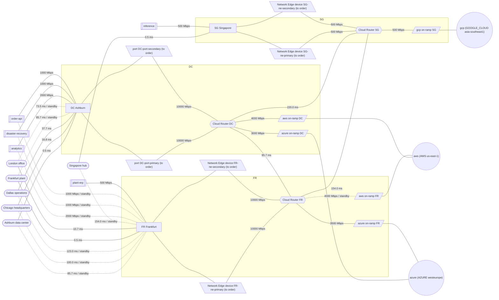

# Metro design for global-interconnect

- Status: Proposed
- Date: 2026-11-18
- Spec: `global-interconnect`, fingerprint `a5f92102787ee30f40ab911fee6c2caf9ba279c5ead65986a92ba8d9b2a9a7da`
- Produced by: equinix-sdk-java development build (no jar manifest version), decision record schema 1

## Context

Private access to three clouds from six sites, with peering and internet breakout.

Sites:

- Ashburn data center: metro DC, data center, weight 3
- Chicago headquarters: metro CH, headquarters, 1200 people
- Dallas operations: metro DA, employee hub, 400 people
- London office: metro LD, primary market, 600 people
- Frankfurt plant: metro FR, manufacturing, 300 people
- Singapore hub: metro SG, branch office, 250 people

Workloads:

- order-api: 1000 Mbps; reaches aws; round trip at most 250 ms from every site; type TRANSACTIONAL
- analytics: 2000 Mbps; reaches aws, azure; type BIG_DATA_ANALYTICS
- inference: 500 Mbps; reaches gcp; pinned to SG; type AI_ML_INFERENCE
- plant-erp: 500 Mbps; reaches azure; pinned to FR; type CUSTOM
- disaster-recovery: 1000 Mbps; reaches aws, azure; type DISASTER_RECOVERY

Clouds:

- aws: AWS, region us-east-1, required, 60,000 GB/month out
- azure: AZURE, region westeurope, required, 30,000 GB/month out
- gcp: GOOGLE_CLOUD, region asia-southeast1, required, 15,000 GB/month out

Peer networks:

- AS13335 (CDN and DNS provider)
- AS20940 (Content delivery provider)
- AS8075 (SaaS productivity provider)

Constraints:

- Must include metros DC, FR
- Must have a metro in each of AMER, EMEA, APAC
- Redundancy at least MULTI_REGION
- Metros per design: 3 to 4
- At least 40% of service must survive the worst single failure
- Monthly cost at most USD 60,000.00

Objectives: explicit weights; weights latency 30%, cost 20%, provider_coverage 20%, resilience 15%, compliance 5%, carbon 10%.

Commercial terms:

- Currency USD
- Term MONTH_12
- Traffic growth 30%/year
- Horizon 36 months

## Decision

Deploy in **DC (Ashburn) + FR (Frankfurt) + SG (Singapore)** (portfolio `DC+FR+SG`, weighted score 89.4 of 100).

DC+FR+SG has the highest weighted score (89.4 of 100) of the 15 feasible design(s) out of 814,385 examined; no feasible design is at least as good on every objective. Weights: latency 30%, cost 20%, provider_coverage 20%, resilience 15%, carbon 10%, compliance 5%. The closest alternative is AM+DC+FR+SG (86.3).

| Objective | Value | Score | Weight | Scale |
|---|---:|---:|---:|---|
| latency | 16.0 ms | 92.0 | 30% | fixed: 0 scores 100, 200 scores 0 |
| cost | USD 15,943.34/month | 100.0 | 20% | ratio to the best option (twice as much scores 50) |
| provider_coverage | 100.0% | 100.0 | 20% | the percentage itself |
| resilience | 82.2% | 82.2 | 15% | the percentage itself |
| compliance | 100.0% | 100.0 | 5% | the percentage itself |
| carbon | 390.19 gCO2e/kWh | 44.3 | 10% | fixed: 0 scores 100, 700 scores 0 |

Placement:

- order-api: runs in DC (site-weighted round trip 49.2 ms), reaching aws; standby in FR; not honoured: FR reaches aws through another region than us-east-1; traffic to us-east-1 continues over the provider's network, which is not modelled or priced
- analytics: runs in DC (site-weighted round trip 49.2 ms), reaching aws, azure; standby in FR; not honoured: FR reaches aws through another region than us-east-1; traffic to us-east-1 continues over the provider's network, which is not modelled or priced
- inference: pinned to SG (site-weighted round trip 177.2 ms), reaching gcp
- plant-erp: pinned to FR (site-weighted round trip 78.2 ms), reaching azure
- disaster-recovery: runs in DC (site-weighted round trip 49.2 ms), reaching aws, azure; standby in FR; not honoured: FR reaches aws through another region than us-east-1; traffic to us-east-1 continues over the provider's network, which is not modelled or priced

Constraints checked:

- required_metros: includes every required metro [DC, FR]
- required_regions: has a metro in every required region [AMER, EMEA, APAC]
- minimum_redundancy: MULTI_REGION met: 3 metros in [AMER, EMEA, APAC]
- metro_count: 3 metros within 3..4
- pinned_workloads: pinned workloads placed: inference@SG, plant-erp@FR
- workload_max_latency: 1 workload latency limit(s) met
- required_clouds: every required cloud is reachable where it is needed
- budget: USD 15943.34/month within budget 60000
- every_metro_used: every metro carries a workload or a cloud connection
- min_survival: 80% survives the worst single failure (minimum 40%)

## Consequences

- Cost: USD 15,943.34 per month (range USD 13,586.31 to USD 18,300.41).
- Resilience: N-1 fails: 6 of all 45 scenarios cause an outage and 2 degrade service.
- 6 single point(s) of failure, the first: loss of metro FR: workloads down: plant-erp; required clouds lost: azure.
- The decision holds while each weight stays within: latency 0% to 48%; cost 10% to 100%; other weights can take any value.
- 10 critical or high finding(s); see appendix D.
- Implementation: 3 Cloud Router(s), 5 provider connection(s), 3 backbone link(s), 27 plan step(s).

## Alternatives considered

814,385 portfolios examined, 15 feasible, 5 on the Pareto frontier (exhaustive search).

| Option | Score | latency | cost | provider_coverage | resilience | compliance | carbon | Gains vs recommendation | Gives up vs recommendation |
|---|---:|---:|---:|---:|---:|---:|---:|---|---|
| **DC+FR+SG** (chosen) | 89.4 | 16.0 ms | USD 15,943.34/month | 100.0% | 82.2% | 100.0% | 390.19 gCO2e/kWh | - | - |
| CH+DC+FR+SG | 87.6 | 5.4 ms | USD 19,197.90/month | 100.0% | 82.2% | 100.0% | 390.19 gCO2e/kWh | latency 5.4 ms vs 16.0 ms | cost USD 19,197.90/month vs USD 15,943.34/month |
| DC+FR+SG+TR | 86.7 | 11.9 ms | USD 19,111.58/month | 100.0% | 82.2% | 100.0% | 390.19 gCO2e/kWh | latency 11.9 ms vs 16.0 ms | cost USD 19,111.58/month vs USD 15,943.34/month |
| AM+DC+FR+SG | 86.3 | 14.9 ms | USD 18,972.89/month | 100.0% | 82.2% | 100.0% | 390.19 gCO2e/kWh | latency 14.9 ms vs 16.0 ms | cost USD 18,972.89/month vs USD 15,943.34/month |
| DC+FR+MA+SG | 86.3 | 14.8 ms | USD 19,087.75/month | 100.0% | 82.2% | 100.0% | 390.19 gCO2e/kWh | latency 14.8 ms vs 16.0 ms | cost USD 19,087.75/month vs USD 15,943.34/month |

Rejected by constraint:

| Constraint | Binding | Rejected alone | Chosen without it | Explanation |
|---|---|---:|---|---|
| required_metros | yes | 140 | FR+SG+TR | binding: without it FR+SG+TR would be recommended (140 portfolio(s) rejected by it alone) |
| required_regions | no | 0 | - | rejects no portfolio on its own |
| minimum_redundancy | no | 0 | - | rejects no portfolio on its own |
| metro_count | no | 0 | - | rejects no portfolio on its own |
| pinned_workloads | no | 0 | - | rejects no portfolio on its own |
| workload_max_latency | no | 0 | - | rejects no portfolio on its own |
| required_clouds | no | 0 | - | rejects no portfolio on its own |
| budget | no | 0 | - | rejects no portfolio on its own |
| every_metro_used | yes | 50 | DC+FR+HO+SG | binding: without it DC+FR+HO+SG would be recommended (50 portfolio(s) rejected by it alone) |
| min_survival | no | 0 | - | rejects no portfolio on its own |

Search notes:

- Portfolios rejected, by the first constraint that failed: {required_metros=812240, required_regions=1275, pinned_workloads=805, every_metro_used=50}.

## Evidence

### A. Sensitivity

| Objective | Weight now | Holds from | Holds to | Below, chosen | Above, chosen |
|---|---:|---:|---:|---|---|
| latency | 30% | 0% | 48% | - | CH+DC+FR+SG |
| cost | 20% | 10% | 100% | CH+DC+FR+SG | - |
| provider_coverage | 20% | 0% | 100% | - | - |
| resilience | 15% | 0% | 100% | - | - |
| compliance | 5% | 0% | 100% | - | - |
| carbon | 10% | 0% | 100% | - | - |

Nearest alternative: AM+DC+FR+SG (score distance 16.0); difference from the recommendation: latency -1.11, cost +3029.55, provider_coverage 0.00, resilience 0.00, compliance 0.00, carbon 0.00.

### B. Cost

| Item | Metro | Monthly | Range | One-time | Source | Note |
|---|---|---:|---|---:|---|---|
| Fabric IP_VC 5000 Mbps DC to aws | DC | USD 375.00 | 375.00 to 375.00 | 0.00 | live | Equinix price ECX00015.PROD; exact (EQUINIX_LIVE) |
| Provider hosted-connection fee aws 5000 Mbps in DC | DC | USD 1,204.50 | 903.38 to 1,505.63 | 0.00 | reference | AWS Direct Connect hosted connection, port-hour by capacity (all locations except Japan; 1 Gbps and above from select partners only), 5000 Mbps: 1.65 USD/h x 730 h = 1204.50 USD/month; source https://aws.amazon.com/directconnect/pricing/, retrieved 2026-11-12; range +/-25% (REFERENCE) |
| Fabric IP_VC 5000 Mbps DC to azure | DC | USD 375.00 | 375.00 to 375.00 | 0.00 | live | Equinix price ECX00015.PROD; exact (EQUINIX_LIVE) |
| Provider hosted-connection fee azure 5000 Mbps in DC | DC | USD 2,180.00 | 1,635.00 to 2,725.00 | 0.00 | reference | Azure ExpressRoute circuit, Standard Metered Data, Zone 1 (monthly); over Equinix Fabric the circuit is ordered through the service-provider (partner) model, 5000 Mbps: 2180 USD/month; source https://prices.azure.com/api/retail/prices?$filter=serviceName eq 'ExpressRoute' and productName eq 'ExpressRoute' and armRegionName eq 'Zone 1' (Standard Metered Data circuits; pricing page https://azure.microsoft.com/en-us/pricing/details/expressroute/), retrieved 2026-11-12; range +/-25% (REFERENCE) |
| Fabric IP_VC 5000 Mbps FR to aws | FR | USD 351.65 | 344.62 to 358.68 | 0.00 | live | Equinix price ECX00015.PROD; exact (EQUINIX_LIVE); converted from EUR 320.0 at 1.0989011 USD/EUR (ECB reference rate via Frankfurter, 2026-11-17, as of 2026-11-17); range widened +/-2% for exchange-rate uncertainty |
| Provider hosted-connection fee aws 5000 Mbps in FR | FR | USD 1,204.50 | 903.38 to 1,505.63 | 0.00 | reference | AWS Direct Connect hosted connection, port-hour by capacity (all locations except Japan; 1 Gbps and above from select partners only), 5000 Mbps: 1.65 USD/h x 730 h = 1204.50 USD/month; source https://aws.amazon.com/directconnect/pricing/, retrieved 2026-11-12; range +/-25% (REFERENCE) |
| Fabric IP_VC 5000 Mbps FR to azure | FR | USD 351.65 | 344.62 to 358.68 | 0.00 | live | Equinix price ECX00015.PROD; exact (EQUINIX_LIVE); converted from EUR 320.0 at 1.0989011 USD/EUR (ECB reference rate via Frankfurter, 2026-11-17, as of 2026-11-17); range widened +/-2% for exchange-rate uncertainty |
| Provider hosted-connection fee azure 5000 Mbps in FR | FR | USD 2,180.00 | 1,635.00 to 2,725.00 | 0.00 | reference | Azure ExpressRoute circuit, Standard Metered Data, Zone 1 (monthly); over Equinix Fabric the circuit is ordered through the service-provider (partner) model, 5000 Mbps: 2180 USD/month; source https://prices.azure.com/api/retail/prices?$filter=serviceName eq 'ExpressRoute' and productName eq 'ExpressRoute' and armRegionName eq 'Zone 1' (Standard Metered Data circuits; pricing page https://azure.microsoft.com/en-us/pricing/details/expressroute/), retrieved 2026-11-12; range +/-25% (REFERENCE) |
| Fabric IP_VC 500 Mbps SG to gcp | SG | USD 151.30 | 148.28 to 154.33 | 0.00 | live | Equinix price ECX00015.PROD; exact (EQUINIX_LIVE); converted from SGD 195.0 at 0.77591558 USD/SGD (ECB reference rate via Frankfurter, 2026-11-17, as of 2026-11-17); range widened +/-2% for exchange-rate uncertainty |
| Provider hosted-connection fee gcp 500 Mbps in SG | SG | USD 126.73 | 95.05 to 158.41 | 0.00 | reference | Google Cloud Partner Interconnect VLAN attachment by capacity (hourly), 500 Mbps: 0.1736 USD/h x 730 h = 126.73 USD/month; source https://cloud.google.com/network-connectivity/docs/interconnect/pricing, retrieved 2026-11-12; range +/-25% (REFERENCE) |
| Fabric Cloud Router STANDARD in DC | DC | USD 1,275.00 | 1,275.00 to 1,275.00 | 0.00 | live | Equinix price ECX00014.PROD; exact (EQUINIX_LIVE) |
| Fabric Cloud Router STANDARD in FR | FR | USD 1,195.60 | 1,171.69 to 1,219.52 | 0.00 | live | Equinix price ECX00014.PROD; exact (EQUINIX_LIVE); converted from EUR 1088.0 at 1.0989011 USD/EUR (ECB reference rate via Frankfurter, 2026-11-17, as of 2026-11-17); range widened +/-2% for exchange-rate uncertainty |
| Fabric Cloud Router STANDARD in SG | SG | USD 1,276.38 | 1,250.85 to 1,301.91 | 0.00 | live | Equinix price ECX00014.PROD; exact (EQUINIX_LIVE); converted from SGD 1645.0 at 0.77591558 USD/SGD (ECB reference rate via Frankfurter, 2026-11-17, as of 2026-11-17); range widened +/-2% for exchange-rate uncertainty |
| Fabric backbone IP_VC 10000 Mbps DC to FR | DC | USD 500.00 | 500.00 to 500.00 | 0.00 | live | Equinix price ECX00015.PROD; exact (EQUINIX_LIVE); assumed: a full mesh between Cloud Routers at 10000 Mbps, the Deployment Wizard's default |
| Fabric backbone IP_VC 10000 Mbps DC to SG | DC | USD 500.00 | 500.00 to 500.00 | 0.00 | live | Equinix price ECX00015.PROD; exact (EQUINIX_LIVE); assumed: a full mesh between Cloud Routers at 10000 Mbps, the Deployment Wizard's default |
| Fabric backbone IP_VC 10000 Mbps FR to SG | FR | USD 467.03 | 457.69 to 476.37 | 0.00 | live | Equinix price ECX00015.PROD; exact (EQUINIX_LIVE); assumed: a full mesh between Cloud Routers at 10000 Mbps, the Deployment Wizard's default; converted from EUR 425.0 at 1.0989011 USD/EUR (ECB reference rate via Frankfurter, 2026-11-17, as of 2026-11-17); range widened +/-2% for exchange-rate uncertainty |
| Data out of aws, 60000 GB/month over the private path | - | USD 1,200.00 | 900.00 to 1,500.00 | 0.00 | reference | Direct Connect data transfer out, contiguous US to US locations; 0.02/GB; range +/-25% (REFERENCE) |
| Data out of azure, 30000 GB/month over the private path | - | USD 750.00 | 562.50 to 937.50 | 0.00 | reference | ExpressRoute Metered Data - Data Transfer Out, Zone 1; 0.025/GB; range +/-25% (REFERENCE) |
| Data out of gcp, 15000 GB/month over the private path | - | USD 279.00 | 209.25 to 348.75 | 0.00 | reference | Cloud Interconnect data transfer, United States/Canada connection location; converted from per-GiB list price (0.02 USD/GiB = 0.0186 per decimal GB); 0.0186/GB; range +/-25% (REFERENCE) |
| **Total** | | **USD 15,943.34** | 13,586.31 to 18,300.41 | 0.00 | |  |

Exchange rates used:

| From | To | Rate | Kind | Source | As of | Band |
|---|---|---:|---|---|---|---:|
| EUR | USD | 1.0989011 | LIVE | ECB reference rate via Frankfurter, 2026-11-17 | 2026-11-17 | +/-2% |
| SGD | USD | 0.77591558 | LIVE | ECB reference rate via Frankfurter, 2026-11-17 | 2026-11-17 | +/-2% |

#### Term and growth

Traffic growth 30.0%/year over 36 months. On-demand total over the horizon: USD 668,794.84.

| Item | Upgrade | Recommended term | Why |
|---|---|---|---|
| Fabric IP_VC DC to aws | month 12 | MONTH_1 | MONTH_1 has the lowest total over 36 months among 4 priced option(s) (ties go to the shorter term) |
| Provider hosted-connection fee aws in DC | month 12 | MONTH_1 | no term axis: priced on demand |
| Fabric IP_VC DC to azure | month 25 | MONTH_1 | MONTH_1 has the lowest total over 36 months among 4 priced option(s) (ties go to the shorter term) |
| Provider hosted-connection fee azure in DC | month 25 | MONTH_1 | no term axis: priced on demand |
| Fabric IP_VC FR to aws | month 12 | MONTH_1 | MONTH_1 has the lowest total over 36 months among 4 priced option(s) (ties go to the shorter term) |
| Provider hosted-connection fee aws in FR | month 12 | MONTH_1 | no term axis: priced on demand |
| Fabric IP_VC FR to azure | month 18 | MONTH_1 | MONTH_1 has the lowest total over 36 months among 4 priced option(s) (ties go to the shorter term) |
| Provider hosted-connection fee azure in FR | month 18 | MONTH_1 | no term axis: priced on demand |
| Fabric IP_VC SG to gcp | month 2 | MONTH_1 | MONTH_1 has the lowest total over 36 months among 4 priced option(s) (ties go to the shorter term) |
| Provider hosted-connection fee gcp in SG | month 2 | MONTH_1 | no term axis: priced on demand |
| Fabric Cloud Router STANDARD in DC | none in horizon | MONTH_36 | MONTH_36 has the lowest total over 36 months among 4 priced option(s) (ties go to the shorter term) |
| Fabric Cloud Router STANDARD in FR | none in horizon | MONTH_36 | MONTH_36 has the lowest total over 36 months among 4 priced option(s) (ties go to the shorter term) |
| Fabric Cloud Router STANDARD in SG | none in horizon | MONTH_36 | MONTH_36 has the lowest total over 36 months among 4 priced option(s) (ties go to the shorter term) |
| Data out of aws | none in horizon | MONTH_1 | no term axis: priced on demand |
| Data out of azure | none in horizon | MONTH_1 | no term axis: priced on demand |
| Data out of gcp | none in horizon | MONTH_1 | no term axis: priced on demand |

#### TCO and savings

Compared for cloud `aws`.

- The private path saves USD 1,345.50 per month net at 60,000 GB/month.
- TCO over MONTH_12: cheapest archetype EQUINIX_INTERCONNECT, USD 1,345.50 per month below PUBLIC_CLOUD_INTERNET.

### C. Resilience

Analysed portfolio: `DC+FR+SG`.

- N-1 FAIL: N-1 fails: 6 of all 45 scenarios cause an outage and 2 degrade service.
- N-2 FAIL: N-2 fails: 245 of all 915 scenarios cause an outage and 74 degrade service.

Single points of failure:

- loss of metro FR: workloads down: plant-erp; required clouds lost: azure
- loss of metro SG: workloads down: inference; required clouds lost: gcp
- loss of the Cloud Router in FR: workloads down: plant-erp; required clouds lost: azure
- loss of the Cloud Router in SG: workloads down: inference; required clouds lost: gcp
- loss of the gcp on-ramp in SG: workloads down: inference; required clouds lost: gcp
- loss of the connection gcp@SG: workloads down: inference; required clouds lost: gcp

Correlated risks:

- None

Estimated availability. These are computed from planning assumptions, not SLAs: SDK planning assumptions (round figures chosen 2026-11-12 for comparison only; NOT Equinix or cloud-provider SLAs: Equinix publishes SLAs per product, replace these with your contractual figures).

| Workload | Availability | Downtime per year | Composition |
|---|---:|---:|---|
| order-api | 99.9898% | 54 min | parallel([metro DC x access 1.000000 x router DC x conn aws@DC x on-ramp], [metro FR x access 0.999998 x router FR x conn aws@FR x on-ramp]) x cloud region(s) [AWS us-east-1] x site access 0.999999 |
| analytics | 99.9794% | 108 min | parallel([metro DC x access 1.000000 x router DC x conn aws@DC x on-ramp x conn azure@DC x on-ramp], [metro FR x access 0.999998 x router FR x conn aws@FR x on-ramp x conn azure@FR x on-ramp]) x cloud region(s) [AWS us-east-1, AZURE westeurope] x site access 0.999999 |
| inference | 99.8697% | 685 min | [metro SG x access 0.999998 x router SG x conn gcp@SG x on-ramp] x cloud region(s) [GOOGLE_CLOUD asia-southeast1] x site access 0.999999 |
| plant-erp | 99.8697% | 685 min | [metro FR x access 0.999998 x router FR x conn azure@FR x on-ramp] x cloud region(s) [AZURE westeurope] x site access 0.999999 |
| disaster-recovery | 99.9794% | 108 min | parallel([metro DC x access 1.000000 x router DC x conn aws@DC x on-ramp x conn azure@DC x on-ramp], [metro FR x access 0.999998 x router FR x conn aws@FR x on-ramp x conn azure@FR x on-ramp]) x cloud region(s) [AWS us-east-1, AZURE westeurope] x site access 0.999999 |

Per-element availability assumed: ACCESS_CONNECTION 0.99950, ACCESS_PORT 0.99990, BACKBONE_LINK 0.99990, CLOUD_CONNECTION 0.99950, CLOUD_ONRAMP 0.99950, CLOUD_REGION 0.99990, CLOUD_ROUTER 0.99990, CROSS_CONNECT 0.99990, EDGE_DEVICE 0.99900, METRO 0.99990, SITE_ACCESS 0.99900.

Remediation:

- Add a standby gcp connection in DC sized for 500 Mbps (DC already reaches gcp; re-simulated: the scenario no longer hurts)
- Raise the azure@DC connection from 3000 to 3500 Mbps (after loss of the azure on-ramp in FR the surviving connections carry more than they are sized for; re-simulated: the scenario no longer hurts)
- Add a second, redundant azure connection in FR (a Fabric redundant pair on separate ports) sized for 500 Mbps (a second connection on the same on-ramp survives the loss of one connection, not of the on-ramp or the metro; re-simulated: the scenario no longer hurts)
- Add a metro to fail over to (no candidate among the nearest 5 removed loss of metro FR when re-simulated) (the design has no metro to fail over to)
- Add a metro to fail over to (no candidate among the nearest 5 removed loss of metro SG when re-simulated) (the design has no metro to fail over to)
- Add a metro to fail over to (no candidate among the nearest 5 removed loss of the entire Equinix APAC region when re-simulated) (every metro of the design is in APAC)
- Add a metro to fail over to (no candidate among the nearest 5 removed loss of the entire Equinix EMEA region when re-simulated) (every metro of the design is in EMEA)
- Add a second Cloud Router in FR and duplicate its connections on it, or give the affected workloads a standby metro (the router carries every cloud and inter-metro path of FR (not re-simulated: a twin router changes the design shape))
- Add a second Cloud Router in SG and duplicate its connections on it, or give the affected workloads a standby metro (the router carries every cloud and inter-metro path of SG (not re-simulated: a twin router changes the design shape))
- Add a second region of the affected cloud as another cloud in the spec and connect to it: outage of cloud region AWS us-east-1 (clouds aws) is outside anything the Equinix design can protect (a cloud-provider region outage takes every on-ramp to it)
- Add a second region of the affected cloud as another cloud in the spec and connect to it: outage of cloud region AZURE westeurope (clouds azure) is outside anything the Equinix design can protect (a cloud-provider region outage takes every on-ramp to it)
- Add a second region of the affected cloud as another cloud in the spec and connect to it: outage of cloud region GOOGLE_CLOUD asia-southeast1 (clouds gcp) is outside anything the Equinix design can protect (a cloud-provider region outage takes every on-ramp to it)
- Add a standby azure connection in SG sized for 500 Mbps (SG already reaches azure; re-simulated: not sufficient on its own)
- Give workload 'inference' a standby metro (it has none: pinned, or no second metro reaches all its clouds) (it cannot fail over)
- Give workload 'plant-erp' a standby metro (it has none: pinned, or no second metro reaches all its clouds) (it cannot fail over)

Notes:

- Placement of 'order-api': FR reaches aws through another region than us-east-1; traffic to us-east-1 continues over the provider's network, which is not modelled or priced
- Placement of 'analytics': FR reaches aws through another region than us-east-1; traffic to us-east-1 continues over the provider's network, which is not modelled or priced
- Placement of 'disaster-recovery': FR reaches aws through another region than us-east-1; traffic to us-east-1 continues over the provider's network, which is not modelled or priced

### D. Risks and findings

| Severity | Source | Category | Finding | Action |
|---|---|---|---|---|
| HIGH | optimizer | PLACEMENT_GAP | 'analytics': FR reaches aws through another region than us-east-1; traffic to us-east-1 continues over the provider's network, which is not modelled or priced | - |
| HIGH | optimizer | PLACEMENT_GAP | 'disaster-recovery': FR reaches aws through another region than us-east-1; traffic to us-east-1 continues over the provider's network, which is not modelled or priced | - |
| HIGH | optimizer | PLACEMENT_GAP | 'order-api': FR reaches aws through another region than us-east-1; traffic to us-east-1 continues over the provider's network, which is not modelled or priced | - |
| HIGH | resilience | N1_FAIL | N-1 fails: 6 of all 45 scenarios cause an outage and 2 degrade service. | Apply the remediations in the resilience section |
| HIGH | resilience | SINGLE_POINT_OF_FAILURE | loss of metro FR: workloads down: plant-erp; required clouds lost: azure | - |
| HIGH | resilience | SINGLE_POINT_OF_FAILURE | loss of metro SG: workloads down: inference; required clouds lost: gcp | - |
| HIGH | resilience | SINGLE_POINT_OF_FAILURE | loss of the Cloud Router in FR: workloads down: plant-erp; required clouds lost: azure | - |
| HIGH | resilience | SINGLE_POINT_OF_FAILURE | loss of the Cloud Router in SG: workloads down: inference; required clouds lost: gcp | - |
| HIGH | resilience | SINGLE_POINT_OF_FAILURE | loss of the connection gcp@SG: workloads down: inference; required clouds lost: gcp | - |
| HIGH | resilience | SINGLE_POINT_OF_FAILURE | loss of the gcp on-ramp in SG: workloads down: inference; required clouds lost: gcp | - |
| MEDIUM | optimizer | CLOUD_REGION_NOT_LOCAL | FR reaches aws through another region than us-east-1; traffic to us-east-1 continues over the provider's network, which is not modelled or priced (workload 'order-api'). | Add a metro whose on-ramp serves the named region, drop the region from the spec to accept any on-ramp, or plan the provider-side path (for AWS, a Direct Connect gateway) yourself |
| LOW | resilience | N2_FAIL | N-2 fails: 245 of all 915 scenarios cause an outage and 74 degrade service. | - |
| INFO | optimizer | COST_CURRENCY_CONVERTED | 6 of 19 line(s) converted to USD: EUR at ECB reference rate via Frankfurter, 2026-11-17; SGD at ECB reference rate via Frankfurter, 2026-11-17. Not a risk: pin the rates (OptimizationResult.specWithUsedRatesPinned()) to reproduce the run | - |
| INFO | optimizer | NATIVE_MULTICLOUD_ALTERNATIVE | Workload 'analytics' depends on Amazon Web Services and Microsoft Azure. The multicloud environment catalog (as of 2026-09-21) lists 4 environment(s) for the pair, none matched to a region in this spec. A native provider-to-provider link carries traffic between the two clouds without an Equinix metro. Informational: not a risk | Plan with the Deployment Wizard's default CloudToCloudStrategy.COMPARE to price both paths |
| INFO | optimizer | NATIVE_MULTICLOUD_ALTERNATIVE | Workload 'disaster-recovery' depends on Amazon Web Services and Microsoft Azure. The multicloud environment catalog (as of 2026-09-21) lists 4 environment(s) for the pair, none matched to a region in this spec. A native provider-to-provider link carries traffic between the two clouds without an Equinix metro. Informational: not a risk | Plan with the Deployment Wizard's default CloudToCloudStrategy.COMPARE to price both paths |

### E. Assumptions and provenance

Site to metro round trips of the recommendation: 15 measured by Fabric, 3 estimated, 0 unknown.

Unmeasured round trips are the fibre floor x 1.73 (overall, fitted from 2,140 measured pairs, interquartile range 1.52 to 2.01).

As of:

- Fabric catalogue (metros, latencies, service profiles) read 2026-11-18T00:49:57.477464Z
- Exchange rate EUR to USD: ECB reference rate via Frankfurter, 2026-11-17, as of 2026-11-17
- Exchange rate SGD to USD: ECB reference rate via Frankfurter, 2026-11-17, as of 2026-11-17
- Reference rate card as of 2026-11
- Resilience analysis facts gathered 2026-11-18T00:50:20.966610Z
- Record generated 2026-11-18T00:50:44.827445Z

Data notes:

- The Fabric metro catalogue was read to its last page (67 items).
- The Fabric service profile catalogue was read to its last page (436 items).
- Cloud 'aws' names region us-east-1: 41 metro(s) offer the provider through other regions only (AM, BA, BG, CH, CL, CN, DB, DX, FR, HE, HK, IL, JK, JN, KL, LA, LD, LS, MA, MB, MD, ME, ML, MT, MU, MX, OS, PA, PE, RJ, SE, SG, SK, SL, SP, SV, SY, TR, TY, WA, ZH). Workloads are placed in a metro that serves the named region when one is in the design; a connection planned elsewhere states the region it uses.
- Cloud 'gcp' names region asia-southeast1: 47 metro(s) offer the provider through other regions only (AM, AT, BA, BG, CA, CH, CL, CN, DA, DC, DX, FR, GV, HE, HK, JK, JN, LA, LD, LS, MA, MB, MD, ME, MI, ML, MT, MU, MX, NY, OS, PA, PE, PH, RJ, SE, SK, SL, SO, SP, ST, SV, SY, TR, TY, WA, ZH). Workloads are placed in a metro that serves the named region when one is in the design; a connection planned elsewhere states the region it uses.

Assumptions:

- (optimizer) All latencies are round trip. A site in the metro it names is assumed 0.5 ms from it; measured pairs use Fabric's connectedMetros.avgLatency; others are estimated: Unmeasured latencies are estimated as 1.73 x the straight-fibre round-trip floor (median of 2140 Fabric-measured metro pairs, interquartile 1.52-2.01; 5 short or uncoordinated pair(s) left out); per region pair: AMER/AMER 1.81 (374 pairs), AMER/APAC 1.48 (420 pairs), AMER/EMEA 1.63 (644 pairs), APAC/APAC 1.95 (104 pairs), APAC/EMEA 2.00 (345 pairs), EMEA/EMEA 2.01 (253 pairs).
- (optimizer) Each workload runs in one metro; in a design of two or more metros its cloud connections are duplicated at full size in a standby metro (active/standby).
- (optimizer) Cloud connections are Fabric virtual connections from a Cloud Router in each metro that carries one; customer ports, colocation space and power, and site access circuits are not priced.
- (optimizer) Data sent into a cloud is not charged by the providers; only data leaving a cloud is priced.
- (optimizer) A metro that carries no workload and no cloud connection is not a design option (every_metro_used).
- (resilience) Metro access comes from the access plan: a metro joins its Cloud Router through its ports or Network Edge devices, each with one access connection. An item to order is simulated as planned.
- (resilience) One Fabric Cloud Router per metro carries cloud and inter-metro traffic (as the Deployment Wizard plans it); a router is a single element unless the design adds a second.
- (resilience) Inter-metro backbone capacity is not provisioned by the spec: it is left unknown and does not constrain the simulation.
- (resilience) A cloud connection is sized as its primary workloads' bandwidth plus 100% of its standby workloads' bandwidth.
- (resilience) Each site has access circuits into its 2 nearest portfolio metro(s) by round trip (the spec does not state site access); access capacity is unknown.
- (resilience) All latencies are round-trip ms: Fabric measurements where published, calibrated estimates otherwise; an unknown latency is never held against a path.
- (resilience) Failures are of whole elements; partial degradation (packet loss, brown-outs) is not modelled.
- (resilience) N-1 counts single-element failures (metro, Cloud Router, on-ramp, connection); cloud-region and Equinix-region losses are shared-fate events, reported and ranked but not counted in N-1.
- (resilience) Availability figures compose assumed per-element availabilities assuming independent failures (SDK planning assumptions (round figures chosen 2026-11-12 for comparison only; NOT Equinix or cloud-provider SLAs: Equinix publishes SLAs per product, replace these with your contractual figures)).
- (resilience) Availability figures: SDK planning assumptions (round figures chosen 2026-11-12 for comparison only; NOT Equinix or cloud-provider SLAs: Equinix publishes SLAs per product, replace these with your contractual figures).
- (growth) Month n carries today's traffic x (1 + 0.3)^((n - 1)/12); capacity is the next Fabric tier at or above the projected Mbps.
- (growth) A term renews at the same term to the horizon; an upgrade within a term is billed at that term's price for the new tier; months committed beyond the horizon are counted at the last month's price.
- (growth) Provider hosted-connection fees and egress have no term axis and are priced on demand.
- (growth) One-time charges fall in month 1; scenario totals are priced on demand (1-month prices).
- (value) 4000 Mbps of workloads to 'aws' rounded up to the 5000 Mbps Fabric tier.
- (value) The portfolio DC+FR+SG has several metros; the connection is priced in DC.

### F. Implementation and reproduction

| Plan | Value |
|---|---|
| Plan id | `0005a356c1709d3c` |
| Deployment name | global-interconnect |
| Steps | 27 (27 executable) |
| Cloud Routers / connections / backbone links | 3 / 5 / 3 |
| Monthly estimate, Equinix items | USD 6,818.61 (live) |
| One-time estimate | USD 0.00 |
| Validation | failed: Cloud Router 'FCR-DC' (DC) has no notification email: Fabric requires at least one notification recipient to create a Cloud Router. Supply deployment.notifications.; Cloud Router 'FCR-FR' (FR) has no notification email: Fabric requires at least one notification recipient to create a Cloud Router. Supply deployment.notifications.; Cloud Router 'FCR-SG' (SG) has no notification email: Fabric requires at least one notification recipient to create a Cloud Router. Supply deployment.notifications. |

Built by the recorder from the recommendation, priced with Layered[EquinixRateCard > ReferenceRateCard], without deployment inputs (project, account, notification addresses) and without live validation; build it with DeploymentWizard and run dryRun() before executing.

To reproduce: run spec fingerprint `a5f92102787ee30f40ab911fee6c2caf9ba279c5ead65986a92ba8d9b2a9a7da` with SDK development build (no jar manifest version), with these exchange rates pinned in `commercial.exchangeRates`: CAD 0.6997411, EUR 1.0989011, GBP 1.31912199, SGD 0.77591558 (as of 2026-11-17). The pinned spec has fingerprint `880f3de37d1fe8106a25c830d8fe7ecdde6f8229eb717cac75acda8cef8668bd` (`DesignDecisionRecord.reproducibleSpec()`).
