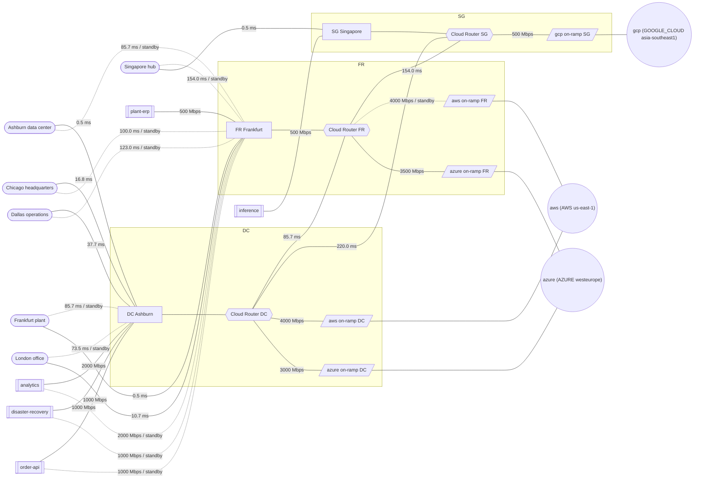

# Resilience report: global-interconnect on DC+FR+SG

Spec fingerprint `a5f92102787ee30f40ab911fee6c2caf9ba279c5ead65986a92ba8d9b2a9a7da`; portfolio from the given optimisation result's recommendation; facts as of 2026-11-16T23:01:22.133089Z.

- **N-1:** N-1 fails: 6 of all 31 scenarios cause an outage and 2 degrade service.
- **N-2:** N-2 fails: 165 of all 418 scenarios cause an outage and 46 degrade service.
- **Single points of failure:** 6
- **Correlated risks:** 0

## Baseline

Service index 100%; sized cloud demand 8000 Mbps.

| Workload | Status | Runs in | Sites | Clouds |
|---|---|---|---|---|
| order-api | full | DC | Ashburn data center: Ashburn data center > DC (0.5 ms); Chicago headquarters: Chicago headquarters > DC (16.8 ms); Dallas operations: Dallas operations > DC (37.7 ms); Frankfurt plant: Frankfurt plant > DC (85.7 ms); London office: London office > DC (73.5 ms); Singapore hub: Singapore hub > SG > DC (220.5 ms) | aws: via conn:aws@DC: DC > on-ramp DC > aws (0.0 ms to the on-ramp) |
| analytics | full | DC | Ashburn data center: Ashburn data center > DC (0.5 ms); Chicago headquarters: Chicago headquarters > DC (16.8 ms); Dallas operations: Dallas operations > DC (37.7 ms); Frankfurt plant: Frankfurt plant > DC (85.7 ms); London office: London office > DC (73.5 ms); Singapore hub: Singapore hub > SG > DC (220.5 ms) | aws: via conn:aws@DC: DC > on-ramp DC > aws (0.0 ms to the on-ramp); azure: via conn:azure@DC: DC > on-ramp DC > azure (0.0 ms to the on-ramp) |
| inference | full | SG | Ashburn data center: Ashburn data center > DC > SG (220.5 ms); Chicago headquarters: Chicago headquarters > DC > SG (236.8 ms); Dallas operations: Dallas operations > DC > SG (257.7 ms); Frankfurt plant: Frankfurt plant > FR > SG (154.5 ms); London office: London office > FR > SG (164.7 ms); Singapore hub: Singapore hub > SG (0.5 ms) | gcp: via conn:gcp@SG: SG > on-ramp SG > gcp (0.0 ms to the on-ramp) |
| plant-erp | full | FR | Ashburn data center: Ashburn data center > FR (85.7 ms); Chicago headquarters: Chicago headquarters > FR (100.0 ms); Dallas operations: Dallas operations > FR (123.0 ms); Frankfurt plant: Frankfurt plant > FR (0.5 ms); London office: London office > FR (10.7 ms); Singapore hub: Singapore hub > FR (154.0 ms) | azure: via conn:azure@FR: FR > on-ramp FR > azure (0.0 ms to the on-ramp) |
| disaster-recovery | full | DC | Ashburn data center: Ashburn data center > DC (0.5 ms); Chicago headquarters: Chicago headquarters > DC (16.8 ms); Dallas operations: Dallas operations > DC (37.7 ms); Frankfurt plant: Frankfurt plant > DC (85.7 ms); London office: London office > DC (73.5 ms); Singapore hub: Singapore hub > SG > DC (220.5 ms) | aws: via conn:aws@DC: DC > on-ramp DC > aws (0.0 ms to the on-ramp); azure: via conn:azure@DC: DC > on-ramp DC > azure (0.0 ms to the on-ramp) |

## Single failures

| Scenario | Verdict | Survival | Site weight affected | Down | Required clouds lost | Capacity served | Shortfall | Breaks |
|---|---|---|---|---|---|---|---|---|
| loss of metro DC | survives | 100% | 0% | - | - | 100% of 8000 Mbps | - | 0 |
| loss of metro FR | outage | 80% | 100% | plant-erp | azure | 94% of 8000 Mbps | 500 Mbps | 0 |
| loss of metro SG | outage | 80% | 100% | inference | gcp | 94% of 8000 Mbps | 500 Mbps | 0 |
| loss of the Cloud Router in DC | survives | 100% | 0% | - | - | 100% of 8000 Mbps | - | 0 |
| loss of the Cloud Router in FR | outage | 80% | 0% | plant-erp | azure | 94% of 8000 Mbps | 500 Mbps | 0 |
| loss of the Cloud Router in SG | outage | 80% | 94% | inference | gcp | 94% of 8000 Mbps | 500 Mbps | 0 |
| loss of the aws on-ramp in DC | survives | 100% | 0% | - | - | 100% of 8000 Mbps | - | 0 |
| loss of the aws on-ramp in FR | unaffected | 100% | 0% | - | - | 100% of 8000 Mbps | - | 0 |
| loss of the azure on-ramp in DC | survives | 100% | 0% | - | - | 100% of 8000 Mbps | - | 0 |
| loss of the azure on-ramp in FR | degraded | 91% | 0% | - | - | 94% of 8000 Mbps | 500.0 Mbps | 0 |
| loss of the gcp on-ramp in SG | outage | 80% | 0% | inference | gcp | 94% of 8000 Mbps | 500 Mbps | 0 |
| loss of the connection aws@DC | survives | 100% | 0% | - | - | 100% of 8000 Mbps | - | 0 |
| loss of the standby connection aws@FR | unaffected | 100% | 0% | - | - | 100% of 8000 Mbps | - | 0 |
| loss of the connection azure@DC | survives | 100% | 0% | - | - | 100% of 8000 Mbps | - | 0 |
| loss of the connection azure@FR | degraded | 91% | 0% | - | - | 94% of 8000 Mbps | 500.0 Mbps | 0 |
| loss of the connection gcp@SG | outage | 80% | 0% | inference | gcp | 94% of 8000 Mbps | 500 Mbps | 0 |
| loss of the access circuit Ashburn data center@DC | survives | 100% | 0% | - | - | 100% of 8000 Mbps | - | 0 |
| loss of the access circuit Ashburn data center@FR | survives | 100% | 0% | - | - | 100% of 8000 Mbps | - | 0 |
| loss of the access circuit Chicago headquarters@DC | survives | 100% | 0% | - | - | 100% of 8000 Mbps | - | 0 |
| loss of the access circuit Chicago headquarters@FR | survives | 100% | 0% | - | - | 100% of 8000 Mbps | - | 0 |
| loss of the access circuit Dallas operations@DC | survives | 100% | 0% | - | - | 100% of 8000 Mbps | - | 0 |
| loss of the access circuit Dallas operations@FR | survives | 100% | 0% | - | - | 100% of 8000 Mbps | - | 0 |
| loss of the access circuit Frankfurt plant@DC | survives | 100% | 0% | - | - | 100% of 8000 Mbps | - | 0 |
| loss of the access circuit Frankfurt plant@FR | survives | 100% | 0% | - | - | 100% of 8000 Mbps | - | 0 |
| loss of the access circuit London office@DC | survives | 100% | 0% | - | - | 100% of 8000 Mbps | - | 0 |
| loss of the access circuit London office@FR | survives | 100% | 0% | - | - | 100% of 8000 Mbps | - | 0 |
| loss of the access circuit Singapore hub@FR | survives | 100% | 0% | - | - | 100% of 8000 Mbps | - | 0 |
| loss of the access circuit Singapore hub@SG | survives | 100% | 0% | - | - | 100% of 8000 Mbps | - | 0 |
| loss of the backbone link DC-FR | unaffected | 100% | 0% | - | - | 100% of 8000 Mbps | - | 0 |
| loss of the backbone link DC-SG | survives | 100% | 0% | - | - | 100% of 8000 Mbps | - | 0 |
| loss of the backbone link FR-SG | survives | 100% | 0% | - | - | 100% of 8000 Mbps | - | 0 |
| outage of cloud region AWS us-east-1 (clouds aws) | outage | 40% | 0% | order-api | aws | 50% of 8000 Mbps | 4000 Mbps | 0 |
| outage of cloud region AZURE westeurope (clouds azure) | outage | 40% | 0% | plant-erp | azure | 56% of 8000 Mbps | 3500 Mbps | 0 |
| outage of cloud region GOOGLE_CLOUD asia-southeast1 (clouds gcp) | outage | 80% | 0% | inference | gcp | 94% of 8000 Mbps | 500 Mbps | 0 |
| loss of the entire Equinix AMER region | survives | 100% | 0% | - | - | 100% of 8000 Mbps | - | 0 |
| loss of the entire Equinix EMEA region | outage | 80% | 100% | plant-erp | azure | 94% of 8000 Mbps | 500 Mbps | 0 |
| loss of the entire Equinix APAC region | outage | 80% | 100% | inference | gcp | 94% of 8000 Mbps | 500 Mbps | 0 |

## Blast radius (worst first)

| # | Scenario | Verdict | Service lost | Site weight affected | Shortfall | Down |
|---|---|---|---|---|---|---|
| 1 | outage of cloud region AWS us-east-1 (clouds aws) | outage | 60% | 0% | 4000 Mbps | order-api |
| 2 | outage of cloud region AZURE westeurope (clouds azure) | outage | 60% | 0% | 3500 Mbps | plant-erp |
| 3 | loss of the entire Equinix APAC region | outage | 20% | 100% | 500 Mbps | inference |
| 4 | loss of the entire Equinix EMEA region | outage | 20% | 100% | 500 Mbps | plant-erp |
| 5 | loss of metro FR | outage | 20% | 100% | 500 Mbps | plant-erp |
| 6 | loss of metro SG | outage | 20% | 100% | 500 Mbps | inference |
| 7 | loss of the Cloud Router in SG | outage | 20% | 94% | 500 Mbps | inference |
| 8 | outage of cloud region GOOGLE_CLOUD asia-southeast1 (clouds gcp) | outage | 20% | 0% | 500 Mbps | inference |
| 9 | loss of the connection gcp@SG | outage | 20% | 0% | 500 Mbps | inference |
| 10 | loss of the gcp on-ramp in SG | outage | 20% | 0% | 500 Mbps | inference |
| 11 | loss of the Cloud Router in FR | outage | 20% | 0% | 500 Mbps | plant-erp |
| 12 | loss of the connection azure@FR | degraded | 9% | 0% | 500.0 Mbps | - |
| 13 | loss of the azure on-ramp in FR | degraded | 9% | 0% | 500.0 Mbps | - |
| 14 | loss of the access circuit Ashburn data center@DC | survives | 0% | 0% | - | - |
| 15 | loss of the access circuit Ashburn data center@FR | survives | 0% | 0% | - | - |

## Single points of failure

- **loss of metro FR** (`metro:FR`): workloads down: plant-erp; required clouds lost: azure
- **loss of metro SG** (`metro:SG`): workloads down: inference; required clouds lost: gcp
- **loss of the Cloud Router in FR** (`router:FR`): workloads down: plant-erp; required clouds lost: azure
- **loss of the Cloud Router in SG** (`router:SG`): workloads down: inference; required clouds lost: gcp
- **loss of the gcp on-ramp in SG** (`onramp:gcp@SG`): workloads down: inference; required clouds lost: gcp
- **loss of the connection gcp@SG** (`conn:gcp@SG`): workloads down: inference; required clouds lost: gcp

## Correlated risks

None found.

## Pairs (N-2)

N-2 fails: 165 of all 418 scenarios cause an outage and 46 degrade service.

| # | Scenario | Verdict | Service lost | Site weight affected | Shortfall | Down |
|---|---|---|---|---|---|---|
| 1 | loss of metro DC AND loss of metro FR | outage | 99% | 100% | 7500 Mbps | order-api, analytics, plant-erp, disaster-recovery |
| 2 | loss of metro FR AND loss of the Cloud Router in DC | outage | 99% | 100% | 7500 Mbps | order-api, analytics, plant-erp, disaster-recovery |
| 3 | loss of metro DC AND loss of the Cloud Router in FR | outage | 99% | 94% | 7500 Mbps | order-api, analytics, plant-erp, disaster-recovery |
| 4 | loss of the Cloud Router in DC AND loss of the Cloud Router in FR | outage | 99% | 94% | 7500 Mbps | order-api, analytics, plant-erp, disaster-recovery |
| 5 | loss of metro FR AND loss of the connection aws@DC | outage | 80% | 100% | 4500 Mbps | order-api, plant-erp |
| 6 | loss of metro FR AND loss of the aws on-ramp in DC | outage | 80% | 100% | 4500 Mbps | order-api, plant-erp |
| 7 | loss of the Cloud Router in FR AND loss of the connection aws@DC | outage | 80% | 0% | 4500 Mbps | order-api, plant-erp |
| 8 | loss of the Cloud Router in FR AND loss of the aws on-ramp in DC | outage | 80% | 0% | 4500 Mbps | order-api, plant-erp |
| 9 | loss of metro FR AND loss of the access circuit Chicago headquarters@DC | outage | 60% | 100% | 500 Mbps | plant-erp |
| 10 | loss of the Cloud Router in FR AND loss of the access circuit Chicago headquarters@DC | outage | 60% | 51% | 500 Mbps | plant-erp |

## Availability estimate

Estimates under the assumptions below, not guarantees: Equinix publishes SLAs per product and the contractual figures are the ones that apply.

| Workload | Core | End to end | Downtime / year | Composition |
|---|---|---|---|---|
| order-api | 99.98986% | 99.98976% | 54 min | parallel([metro DC x router DC x conn aws@DC x on-ramp], [metro FR x router FR x conn aws@FR x on-ramp]) x cloud region(s) [AWS us-east-1] x site access 0.999999 |
| analytics | 99.97952% | 99.97942% | 108 min | parallel([metro DC x router DC x conn aws@DC x on-ramp x conn azure@DC x on-ramp], [metro FR x router FR x conn aws@FR x on-ramp x conn azure@FR x on-ramp]) x cloud region(s) [AWS us-east-1, AZURE westeurope] x site access 0.999999 |
| inference | 99.87006% | 99.86996% | 684 min | [metro SG x router SG x conn gcp@SG x on-ramp] x cloud region(s) [GOOGLE_CLOUD asia-southeast1] x site access 0.999999 |
| plant-erp | 99.87006% | 99.86996% | 684 min | [metro FR x router FR x conn azure@FR x on-ramp] x cloud region(s) [AZURE westeurope] x site access 0.999999 |
| disaster-recovery | 99.97952% | 99.97942% | 108 min | parallel([metro DC x router DC x conn aws@DC x on-ramp x conn azure@DC x on-ramp], [metro FR x router FR x conn aws@FR x on-ramp x conn azure@FR x on-ramp]) x cloud region(s) [AWS us-east-1, AZURE westeurope] x site access 0.999999 |

Assumed availability per element (SDK planning assumptions (round figures chosen 2026-11-12 for comparison only; NOT Equinix or cloud-provider SLAs: Equinix publishes SLAs per product, replace these with your contractual figures)):

- metro: 99.9900%
- cloud router: 99.9900%
- cloud connection: 99.9500%
- cloud onramp: 99.9500%
- backbone link: 99.9900%
- site access: 99.9000%
- cloud region: 99.9900%

## Remediation

- Add a standby gcp connection in DC sized for 500 Mbps **(re-simulated: removes `onramp:gcp@SG`, `conn:gcp@SG`)**: DC already reaches gcp; re-simulated: the scenario no longer hurts
- Raise the azure@DC connection from 3000 to 3500 Mbps **(re-simulated: removes `onramp:azure@FR`, `conn:azure@FR`)**: after loss of the azure on-ramp in FR the surviving connections carry more than they are sized for; re-simulated: the scenario no longer hurts
- Add a second, redundant azure connection in FR (a Fabric redundant pair on separate ports) sized for 500 Mbps **(re-simulated: removes `conn:azure@FR`)**: a second connection on the same on-ramp survives the loss of one connection, not of the on-ramp or the metro; re-simulated: the scenario no longer hurts
- Add a metro to fail over to (no candidate among the nearest 5 removed loss of metro FR when re-simulated) (addresses `metro:FR`): the design has no metro to fail over to
- Add a metro to fail over to (no candidate among the nearest 5 removed loss of metro SG when re-simulated) (addresses `metro:SG`): the design has no metro to fail over to
- Add a metro to fail over to (no candidate among the nearest 5 removed loss of the entire Equinix APAC region when re-simulated) (addresses `equinix-region:APAC`): every metro of the design is in APAC
- Add a metro to fail over to (no candidate among the nearest 5 removed loss of the entire Equinix EMEA region when re-simulated) (addresses `equinix-region:EMEA`): every metro of the design is in EMEA
- Add a second Cloud Router in FR and duplicate its connections on it, or give the affected workloads a standby metro (addresses `router:FR`): the router carries every cloud and inter-metro path of FR (not re-simulated: a twin router changes the design shape)
- Add a second Cloud Router in SG and duplicate its connections on it, or give the affected workloads a standby metro (addresses `router:SG`): the router carries every cloud and inter-metro path of SG (not re-simulated: a twin router changes the design shape)
- Add a second region of the affected cloud as another cloud in the spec and connect to it: outage of cloud region AWS us-east-1 (clouds aws) is outside anything the Equinix design can protect (addresses `cloud-region:AWS/us-east-1`): a cloud-provider region outage takes every on-ramp to it
- Add a second region of the affected cloud as another cloud in the spec and connect to it: outage of cloud region AZURE westeurope (clouds azure) is outside anything the Equinix design can protect (addresses `cloud-region:AZURE/westeurope`): a cloud-provider region outage takes every on-ramp to it
- Add a second region of the affected cloud as another cloud in the spec and connect to it: outage of cloud region GOOGLE_CLOUD asia-southeast1 (clouds gcp) is outside anything the Equinix design can protect (addresses `cloud-region:GOOGLE_CLOUD/asia-southeast1`): a cloud-provider region outage takes every on-ramp to it
- Add a standby azure connection in SG sized for 500 Mbps (addresses `conn:azure@FR`): SG already reaches azure; re-simulated: not sufficient on its own
- Give workload 'inference' a standby metro (it has none: pinned, or no second metro reaches all its clouds) (addresses `metro:SG`): it cannot fail over
- Give workload 'plant-erp' a standby metro (it has none: pinned, or no second metro reaches all its clouds) (addresses `metro:FR`): it cannot fail over

## Design graph

| Edge | Kind | From | To | Role | Capacity | Round trip |
|---|---|---|---|---|---|---|
| access:Ashburn data center@DC | site_access | Ashburn data center | DC Ashburn | primary | unknown | 0.5 ms (intra-metro) |
| access:Ashburn data center@FR | site_access | Ashburn data center | FR Frankfurt | standby | unknown | 85.7 ms (measured) |
| access:Chicago headquarters@DC | site_access | Chicago headquarters | DC Ashburn | primary | unknown | 16.8 ms (measured) |
| access:Chicago headquarters@FR | site_access | Chicago headquarters | FR Frankfurt | standby | unknown | 100.0 ms (measured) |
| access:Dallas operations@DC | site_access | Dallas operations | DC Ashburn | primary | unknown | 37.7 ms (measured) |
| access:Dallas operations@FR | site_access | Dallas operations | FR Frankfurt | standby | unknown | 123.0 ms (measured) |
| access:Frankfurt plant@DC | site_access | Frankfurt plant | DC Ashburn | standby | unknown | 85.7 ms (measured) |
| access:Frankfurt plant@FR | site_access | Frankfurt plant | FR Frankfurt | primary | unknown | 0.5 ms (intra-metro) |
| access:London office@DC | site_access | London office | DC Ashburn | standby | unknown | 73.5 ms (measured) |
| access:London office@FR | site_access | London office | FR Frankfurt | primary | unknown | 10.7 ms (measured) |
| access:Singapore hub@FR | site_access | Singapore hub | FR Frankfurt | standby | unknown | 154.0 ms (measured) |
| access:Singapore hub@SG | site_access | Singapore hub | SG Singapore | primary | unknown | 0.5 ms (intra-metro) |
| attach:DC | router_attachment | DC Ashburn | Cloud Router DC |  | unknown | 0.0 ms (assumed) |
| attach:FR | router_attachment | FR Frankfurt | Cloud Router FR |  | unknown | 0.0 ms (assumed) |
| attach:SG | router_attachment | SG Singapore | Cloud Router SG |  | unknown | 0.0 ms (assumed) |
| backbone:DC-FR | backbone | Cloud Router DC | Cloud Router FR |  | unknown | 85.7 ms (measured) |
| backbone:DC-SG | backbone | Cloud Router DC | Cloud Router SG |  | unknown | 220.0 ms (measured) |
| backbone:FR-SG | backbone | Cloud Router FR | Cloud Router SG |  | unknown | 154.0 ms (measured) |
| conn:aws@DC | cloud_connection | Cloud Router DC | aws on-ramp DC | primary | 4000 Mbps | unknown |
| conn:aws@FR | cloud_connection | Cloud Router FR | aws on-ramp FR | standby | 4000 Mbps | unknown |
| conn:azure@DC | cloud_connection | Cloud Router DC | azure on-ramp DC | primary | 3000 Mbps | unknown |
| conn:azure@FR | cloud_connection | Cloud Router FR | azure on-ramp FR | primary | 3500 Mbps | unknown |
| conn:gcp@SG | cloud_connection | Cloud Router SG | gcp on-ramp SG | primary | 500 Mbps | unknown |
| provider:aws@DC | provider_link | aws on-ramp DC | aws (AWS us-east-1) |  | unknown | unknown |
| provider:aws@FR | provider_link | aws on-ramp FR | aws (AWS us-east-1) |  | unknown | unknown |
| provider:azure@DC | provider_link | azure on-ramp DC | azure (AZURE westeurope) |  | unknown | unknown |
| provider:azure@FR | provider_link | azure on-ramp FR | azure (AZURE westeurope) |  | unknown | unknown |
| provider:gcp@SG | provider_link | gcp on-ramp SG | gcp (GOOGLE_CLOUD asia-southeast1) |  | unknown | unknown |
| host:analytics@DC | workload_hosting | analytics | DC Ashburn | primary | 2000 Mbps | unknown |
| host:analytics@FR | workload_hosting | analytics | FR Frankfurt | standby | 2000 Mbps | unknown |
| host:disaster-recovery@DC | workload_hosting | disaster-recovery | DC Ashburn | primary | 1000 Mbps | unknown |
| host:disaster-recovery@FR | workload_hosting | disaster-recovery | FR Frankfurt | standby | 1000 Mbps | unknown |
| host:inference@SG | workload_hosting | inference | SG Singapore | primary | 500 Mbps | unknown |
| host:order-api@DC | workload_hosting | order-api | DC Ashburn | primary | 1000 Mbps | unknown |
| host:order-api@FR | workload_hosting | order-api | FR Frankfurt | standby | 1000 Mbps | unknown |
| host:plant-erp@FR | workload_hosting | plant-erp | FR Frankfurt | primary | 500 Mbps | unknown |

## Assumptions

- One Fabric Cloud Router per metro carries cloud and inter-metro traffic (as the Deployment Wizard plans it); a router is a single element unless the design adds a second.
- Inter-metro backbone capacity is not provisioned by the spec: it is left unknown and does not constrain the simulation.
- A cloud connection is sized as its primary workloads' bandwidth plus 100% of its standby workloads' bandwidth.
- Each site has access circuits into its 2 nearest portfolio metro(s) by round trip (the spec does not state site access); access capacity is unknown.
- All latencies are round-trip ms: Fabric measurements where published, calibrated estimates otherwise; an unknown latency is never held against a path.
- Failures are of whole elements; partial degradation (packet loss, brown-outs) is not modelled.
- N-1 counts single-element failures (metro, Cloud Router, on-ramp, connection); cloud-region and Equinix-region losses are shared-fate events, reported and ranked but not counted in N-1.
- Availability figures compose assumed per-element availabilities assuming independent failures (SDK planning assumptions (round figures chosen 2026-11-12 for comparison only; NOT Equinix or cloud-provider SLAs: Equinix publishes SLAs per product, replace these with your contractual figures)).

## Notes

- Placement of 'order-api': FR reaches aws through another region than us-east-1; traffic to us-east-1 continues over the provider's network, which is not modelled or priced
- Placement of 'analytics': FR reaches aws through another region than us-east-1; traffic to us-east-1 continues over the provider's network, which is not modelled or priced
- Placement of 'disaster-recovery': FR reaches aws through another region than us-east-1; traffic to us-east-1 continues over the provider's network, which is not modelled or priced

## Timings

- catalogue load: 3651 ms
- graph: 1 ms
- single failures (37): 11 ms
- pairs (418): 51 ms
- remediation: 13 ms
- availability: 1 ms
